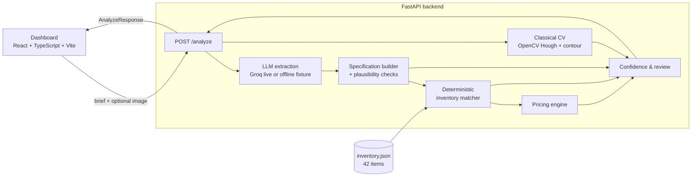
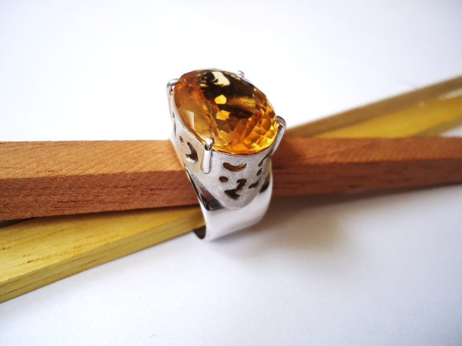
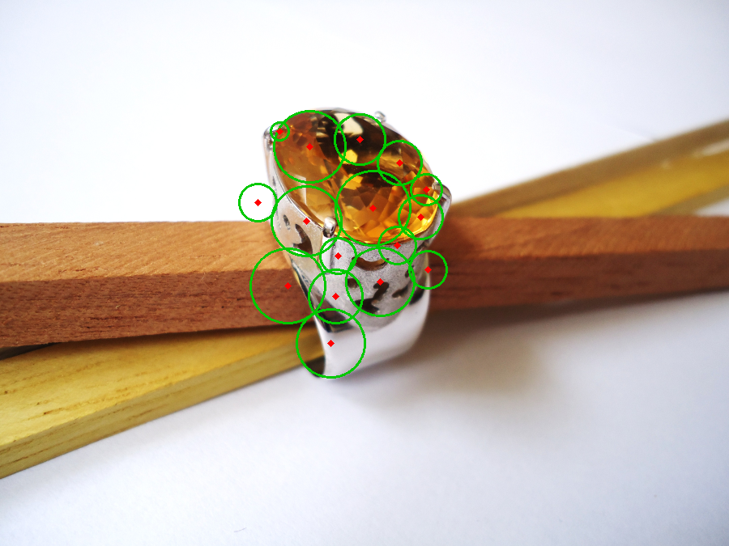
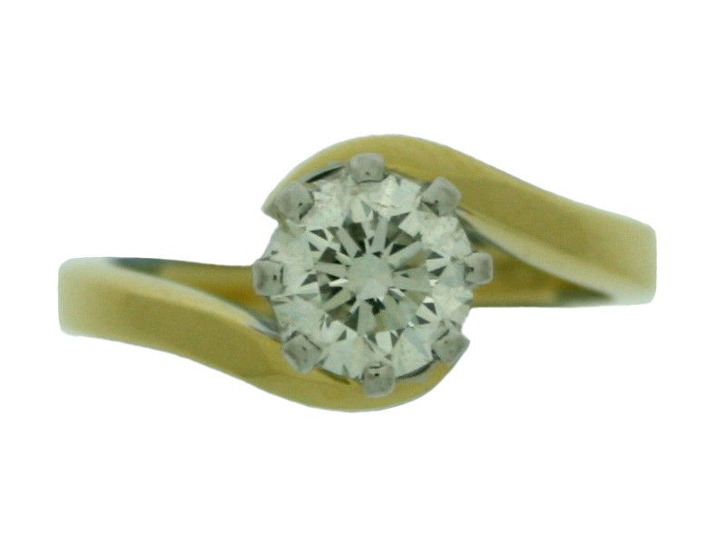
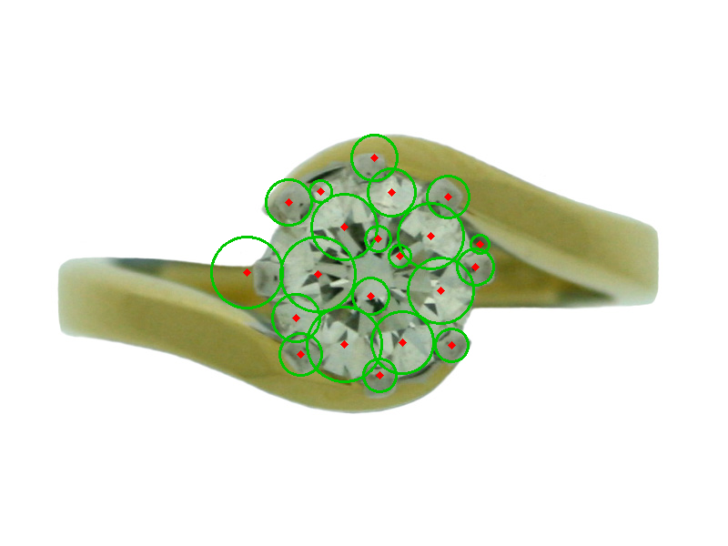

# SpecVision AI

**Live demo:** https://specvision-ai.vercel.app (runs in live LLM mode via Groq -- free tier, so a burst of concurrent use may occasionally hit a rate limit; the app degrades safely and reports this rather than failing silently. See "Deployment" below for architecture and known constraints of this hosted version vs. local/Docker.)

AI-powered product specification and cost estimation for custom jewelry.
Give it a short sales brief and (optionally) a reference photo of a ring,
and it returns a structured specification, a ranked match against a
local inventory catalog, a classical computer-vision estimate of visible
gemstones, an indicative price, and an explicit confidence/review summary
-- never silently inventing a value it isn't sure of.

A short PDF summary with three real test-case results is at
`docs/SpecVision_AI_Summary.pdf` -- the same three cases are walked
through with images in "Example results" below.

## Domain

Custom jewelry, specifically rings and gemstone designs: engagement
rings, wedding bands, eternity bands, solitaires, halo rings, cocktail
rings, and three-stone/cluster designs across gold (10k-24k, all three
colors), platinum, and silver.

## Architecture



Business logic lives entirely in `backend/app/services/*`, independent of
the HTTP layer (`backend/app/api/routes.py`) and independent of the
frontend. No step depends on a paid vision API; the only paid-API
surface is the optional text-extraction LLM call, which has a fully
functional offline deterministic fallback.

## Main workflow

1. User submits a brief (and optional photo) via the dashboard or `POST /analyze`.
2. **Extraction**: a configured LLM (Groq, live mode) or a deterministic
   keyword/regex extractor (offline mode) turns the brief into raw
   attribute values. Output is validated against a strict Pydantic
   schema; malformed/invalid output is retried, then falls back to a
   secondary model, then safely degrades to the offline extractor --
   never a 500 error or a silent guess.
3. **Specification building**: each raw value is wrapped with a source
   (`user_provided` / `model_inferred` / `unknown`) and a confidence
   level, then run through deterministic plausibility checks (implausible
   carat, metal/purity contradictions, etc).
4. **Computer vision** (if an image was supplied): a classical OpenCV
   pipeline (Hough-circle + contour hybrid) estimates the number of
   visible small gemstones, with an honest confidence/quality-warning
   assessment and an annotated detection image.
5. **Inventory matching**: a deterministic, weighted scoring engine ranks
   the 42-item local catalog against the specification -- no LLM
   involved, fully reproducible.
6. **Pricing**: an indicative price is derived from the best-matching
   catalog item plus documented, bounded adjustments (extra carat, extra
   side stones). Never a "confirmed quote."
7. **Confidence & review**: cross-checks the CV estimate against the
   brief, collects every plausibility/matching/pricing concern into
   stable, actionable review flags, and computes an overall status
   (`auto_approved` / `needs_review` / `failed`).

## Example results

Three real, reproducible runs of the actual pipeline (offline/demo mode
-- no API key, no network call, fully deterministic). Source data and
regeneration script: `docs/_build/` and `docs/generate_summary_pdf.py`;
a formatted PDF version of the same three cases is at
`docs/SpecVision_AI_Summary.pdf`.

```powershell
cd backend
.venv\Scripts\Activate.ps1
python ..\evaluation\runner\run_evaluation.py --mode offline
```

### Test case 1 -- successful end-to-end match (text-only)

> "A solitaire ring in 18k yellow gold with a round diamond center stone, about 0.45 carats, tension setting, eight moissanite side stones, band width 1.7mm." (no photo)

| | |
|---|---|
| Metal | 18k yellow gold (HIGH) |
| Design | solitaire (HIGH) |
| Center stone | round diamond, 0.45ct (HIGH) |
| Side stones | 8x moissanite (HIGH) |
| Inventory match | `SV-001` -- "Solitaire Round Yellow Gold Ring" -- **100%** match (threshold 72%), auto-selected |
| Indicative price | **USD 2,568.00** |
| Status | **AUTO_APPROVED** -- no review flags |

Every stated attribute was extracted correctly and matched a real catalog item exactly.

### Test case 2 -- real photo, honest reporting of a CV limitation

> "A sterling silver ring with a large oval citrine centerpiece and an open filigree band, no side stones." (real photo, Wikimedia Commons CC BY-SA -- see `evaluation/images/PROVENANCE.md`)

<p align="center">
  
  
</p>
<p align="center"><sub>Left: original photo. Right: classical CV detections (green circles) overlaid.</sub></p>

| | |
|---|---|
| Metal | 925 sterling silver (HIGH) |
| Center stone type | **Unknown** (LOW) -- "citrine" is not in the controlled gemstone vocabulary; correctly left unknown rather than guessed |
| Side stones (from brief) | 0 (HIGH) |
| **CV result** | **16 visible components, HIGH confidence, no quality warnings** |
| Status | **NEEDS_REVIEW** |

The photo's pierced filigree metalwork was mistaken for 16 small gemstones by the classical detector -- with high self-reported confidence and no warning, even though the ring has zero side stones. This is a real, documented limitation (analyzed in depth as "Failure #1" in `EVALUATION.md`), caught here only because the brief explicitly states "no side stones," triggering a brief-vs-CV disagreement check (`CV_BRIEF_COUNT_DISAGREEMENT`, 1600% relative difference). If the brief hadn't mentioned a side-stone count at all, this error would not have been flagged -- a limitation stated explicitly, not hidden.

### Test case 3 -- real photo, successful match and price despite an honest CV caveat

> "An 18k yellow gold solitaire ring with a round diamond center stone and no side stones." (real photo, Wikimedia Commons CC BY-SA)

<p align="center">
  
  
</p>
<p align="center"><sub>Left: original photo. Right: classical CV detections (green circles) overlaid.</sub></p>

| | |
|---|---|
| Metal | 18k yellow gold (HIGH) |
| Design | solitaire (HIGH) |
| Center stone | round diamond (HIGH) |
| Side stones (from brief) | 0 (HIGH) |
| Inventory match | `SV-001` -- **81%** match (threshold 72%), auto-selected |
| Indicative price | **USD 2,568.00** |
| **CV result** | 21 visible components, MEDIUM confidence, flagged |
| Status | **NEEDS_REVIEW** |

This is a clean studio photo of a plain solitaire with no side stones, but the band's polished-gold highlight still produces enough false-positive detections to push CV confidence down to MEDIUM. Specification extraction, inventory matching, and pricing all succeeded independently of that -- the three subsystems are deliberately decoupled, so a CV caveat on one image doesn't block the rest of the pipeline from producing a usable, priced result. The review flag here reflects the CV module honestly disagreeing with the brief's "no side stones" claim, not an unreliable match or price.

## Technology stack

- **Backend**: Python 3.12+ (developed/tested on 3.14), FastAPI, Pydantic v2, Uvicorn, OpenCV (headless), NumPy, pandas, httpx, pytest.
- **Frontend**: React 18, TypeScript, Vite, Tailwind CSS, lucide-react icons.
- **LLM**: Groq (OpenAI-compatible chat completions API), provider-abstracted -- swappable without touching extraction logic.
- **No database**: the inventory is a committed JSON file; nothing is persisted between requests.

## Repository structure

```
backend/
  app/
    api/            FastAPI routes (HTTP only -- no business logic)
    core/            config, matching weights, pricing constants, logging, image validation
    models/          Pydantic schemas and enums (the API contract)
    services/        extraction, CV, matching, pricing, confidence, pipeline orchestration
    data/            inventory.json (42 items)
  scripts/           generate_inventory.py (regenerates the catalog)
  tests/             pytest suite (51 tests)
  requirements.txt, .env.example, Dockerfile
frontend/
  src/
    api/             typed fetch client
    components/      one component per dashboard section
    types/           TypeScript mirror of the backend schemas
    data/examples.ts bundled example briefs
  public/sample-images/  real sample photos for the "load an example" gallery
  Dockerfile, .env.example
evaluation/
  data/cases.json    16 labeled cases
  images/            7 real CC-licensed photos (+ images/synthetic/ for pytest fixtures)
  runner/            run_evaluation.py
  results/           committed offline + live evaluation output
docker-compose.yml
EVALUATION.md
```

## Setup and execution (Windows / VS Code PowerShell terminal)

### Backend

```powershell
cd backend
python -m venv .venv
.venv\Scripts\Activate.ps1
pip install -r requirements.txt
copy .env.example .env
# edit .env: set GROQ_API_KEY for live mode, or leave APP_MODE=offline
uvicorn app.main:app --reload --port 8000
```

Backend is now at `http://localhost:8000` (docs at `/docs`).

### Frontend

```powershell
cd frontend
npm install
copy .env.example .env
npm run dev
```

Frontend is now at `http://localhost:5173`.

### Tests

```powershell
cd backend
.venv\Scripts\Activate.ps1
pytest -q
```

51 tests, no network/API key required (the live-mode code path is tested
with a mocked provider -- see `backend/tests/test_extraction_live_mocked.py`).

### Evaluation

```powershell
cd backend
.venv\Scripts\Activate.ps1
python ..\evaluation\runner\run_evaluation.py --mode offline   # always works
python ..\evaluation\runner\run_evaluation.py --mode live      # needs GROQ_API_KEY
```

Results are written to `evaluation/results/` (both a machine-readable
JSON and a human-readable Markdown summary) and committed to this repo.
See `EVALUATION.md` for the full report.

### Offline/demo mode

Set `APP_MODE=offline` in `backend/.env` (the default). The app is fully
functional without any API key -- extraction uses a deterministic
keyword/regex rule set instead of an LLM, clearly tagged
`extraction_method: "offline_fixture"` in every response and surfaced in
the frontend's mode badge. Matching, CV, pricing, confidence, and review
all run exactly as in live mode.

### Live LLM mode

1. Get a free API key at [console.groq.com](https://console.groq.com/keys).
2. In `backend/.env`: `APP_MODE=live`, `GROQ_API_KEY=<your key>`.
3. Restart the backend. `GET /health` will report `"live_mode_ready": true`.

The app never silently falls back to offline mode and reports success --
if live extraction fails after retries and a fallback-model attempt, the
response is tagged `extraction_method: "safe_degradation"` and the
`EXTRACTION_DEGRADED` review flag is raised.

### Docker

```powershell
docker compose up --build
```

Backend on `http://localhost:8000`, frontend on `http://localhost:4173`.
Requires `backend/.env` to exist (copy from `.env.example`) since
`docker-compose.yml` loads it via `env_file`.

### Vercel deployment

The live demo linked at the top of this file is deployed as a single
Vercel project using [Services](https://vercel.com/docs/services) --
one `vercel.json` at the repo root declares two services (`frontend`,
the Vite build; `backend`, the FastAPI app) that build independently but
ship as one deployment. Public routing: `/api/*` reaches the backend
(with the `/api` prefix stripped before it hits FastAPI's own route
definitions), everything else serves the frontend SPA. Same origin for
both, so no CORS configuration is needed in production.

```powershell
vercel link --yes --project specvision-ai   # one-time
vercel env add GROQ_API_KEY production
vercel env add APP_MODE production          # "live"
vercel env add MAX_IMAGE_SIZE_BYTES production  # see note below
vercel env add ROOT_PATH production         # "/api" -- see note below
vercel --prod
```

**Known differences from local/Docker, both handled explicitly, not glossed over:**

- Vercel Functions cap request/response bodies at 4.5MB. The local/Docker
  default `MAX_IMAGE_SIZE_BYTES` is 8MB (`backend/.env.example`), which
  would let an upload between 4.5-8MB fail at the platform level with an
  opaque error instead of this app's own clean 413 response. The
  deployed instance overrides this to 4MB via a Vercel environment
  variable so the app's own validation (and its user-facing error
  message) is what actually fires.
- FastAPI's auto-generated Swagger UI (`/docs`) hardcodes an absolute,
  unprefixed `/openapi.json` reference. Reached directly that's fine,
  but behind the Services routing layer's `/api` prefix it isn't --
  the browser would request `/openapi.json` (no prefix), which falls
  through to the frontend's catch-all and serves `index.html` instead
  of the schema, breaking Swagger with "does not specify a valid
  version field." Fixed via FastAPI's own `root_path` mechanism,
  configured through `ROOT_PATH` (empty locally/Docker, `/api` on
  Vercel) -- not a routing-layer workaround, the standard mechanism
  FastAPI provides for exactly this situation.

Classical CV (OpenCV), the live Groq LLM call, and the Swagger docs page
itself were all verified working on the deployed instance by actually
loading them, not assumed from a successful build or a 200 status code
alone -- the Swagger bug above returned 200 on every request involved
and only showed up when the page was actually opened.

## API endpoints

| Method | Path | Description |
|---|---|---|
| GET | `/health` | Service health + safe runtime-mode info (never exposes credentials) |
| GET | `/inventory` | List all 42 catalog items |
| GET | `/inventory/{product_id}` | Retrieve one catalog item (404 if missing) |
| POST | `/analyze` | Full brief-to-estimate pipeline |

`POST /analyze` accepts exactly one content type -- `multipart/form-data`
-- with a required `brief` text field and an optional `image` file part.
This single contract is declared via FastAPI's `Form(...)`/`File(...)`
parameters (not manual request parsing), so it shows up correctly as an
editable brief field and a file-upload control in Swagger UI at `/docs`,
and is machine-checked in `backend/tests/test_api.py::test_openapi_schema_declares_analyze_request_body`.
A brief-only request is just this same form with no `image` part -- there
is no separate JSON variant.

Example (brief-only):
```powershell
curl -X POST http://localhost:8000/analyze -F "brief=An 18k yellow gold engagement ring with a round diamond."
```

Example (with image):
```powershell
curl -X POST http://localhost:8000/analyze -F "brief=A silver ring with a citrine center stone." -F "image=@photo.jpg;type=image/jpeg"
```

Response schema: see `backend/app/models/schemas.py` (`AnalyzeResponse`)
or `frontend/src/types/api.ts` for the equivalent TypeScript contract --
the frontend consumes the real response shape with no fabricated fields.
The frontend always sends `FormData` (never a manually-set multipart
`Content-Type` header -- the browser generates the boundary itself).

Validation: empty/whitespace-only or missing brief -> 422; brief over
4000 characters -> 422; a non-multipart request (e.g. JSON) -> 422, since
`brief` is reported as a missing required field, the same structured
error FastAPI uses for any other missing field; image over 8MB -> 413;
image failing magic-byte format sniffing -> 415; unexpected internal
error -> 500 with a generic message (no stack trace or credentials ever
returned).

## Environment configuration

See `backend/.env.example` and `frontend/.env.example` for the full list.
Key variables: `APP_MODE` (`offline`/`live`), `LLM_PROVIDER`,
`LLM_PRIMARY_MODEL`, `LLM_FALLBACK_MODEL`, `GROQ_API_KEY`,
`MATCH_AUTO_SELECT_THRESHOLD`, `MAX_IMAGE_SIZE_BYTES`,
`CORS_ALLOW_ORIGINS`, `VITE_API_URL` (frontend). `.env` files are
git-ignored; only `.env.example` (placeholders) is committed.

## Inventory matching: formula and thresholds

Deterministic, weighted attribute scoring -- **no LLM involved**.
Weights (sum to 1.0, documented with rationale in
`backend/app/core/matching_weights.py`):

| Attribute | Weight |
|---|---|
| Center stone type | 0.20 |
| Design category | 0.15 |
| Setting type | 0.10 |
| Center stone shape | 0.10 |
| Center stone carat | 0.10 |
| Metal type | 0.10 |
| Metal purity | 0.05 |
| Metal color | 0.05 |
| Side stone count | 0.08 |
| Side stone type | 0.04 |
| Band width | 0.03 |

Each attribute is scored exact-match (1.0) / partial-match (0.35-0.75,
numeric attributes within a documented tolerance band) / contradiction
(0.0) / missing-data (0.5 neutral -- doesn't reward or punish absent
evidence). Candidates are ranked by total score descending, with stable
`product_id` tie-breaking. A candidate is auto-selected only if its score
meets `MATCH_AUTO_SELECT_THRESHOLD` (default 0.72); otherwise the top 3
are still returned for reference, explicitly marked as not meeting the
threshold.

**Why deterministic, not LLM-based:** repeatable (same input always
produces the same ranking), fully explainable (every attribute's
contribution is itemized), zero per-request API cost, and reproducible
for evaluation -- an LLM reranker would make `backend/tests/test_matching.py`'s
determinism tests impossible to write meaningfully.

## Computer vision approach

Classical OpenCV pipeline (no paid vision API, no deep model): decode and
validate the image -> resize to a working resolution -> grayscale + CLAHE
contrast enhancement -> Hough-circle detection (catches round-cut stones
and reflective highlights) run in parallel with adaptive-threshold +
morphological + contour analysis (catches non-circular cuts like
princess/emerald) -> geometric size filtering -> duplicate suppression
between the two detection sets -> confidence assessment grounded in
detection-count plausibility and image-quality signals (brightness,
contrast, blur, computed over a centered region of interest) -> optional
annotated-image rendering.

Known, documented failure modes (see `EVALUATION.md` for concrete
examples from real photos): ornate filigree/pierced metalwork can be
mistaken for small stones; princess-cut facet reflections against a
textured background can cause severe overcounting; very small, blurry,
or low-resolution images are explicitly rejected rather than guessed at.
A visible-stone count is never presented as the finished product's true
stone count -- it is cross-checked against any count implied by the
brief, with disagreements above a 40% relative-difference threshold
(`CV_VS_BRIEF_DISAGREEMENT_RATIO`) raising a review flag.

## Confidence and human-review policy

Confidence is never self-reported by the LLM. Every specification field
gets a source (`user_provided`/`model_inferred`/`unknown`) and a
confidence level derived from: whether the value was stated verbatim in
the brief vs. inferred, whether it passed deterministic plausibility
checks (carat/size/purity sanity ranges, metal-type/purity consistency),
and (for CV) detection-count stability and image-quality signals.

Review is triggered (stable codes, severity, message, recommended
action -- see `backend/app/services/confidence.py`) for: implausible
quantities, metal/purity contradictions, CV/brief disagreement above
threshold, no reliable inventory match, insufficient image quality,
pricing-relevant fields missing/uncertain, and degraded/recovered
extraction. `INFO`-severity events (e.g. "extraction recovered after one
retry") are informational and don't force `needs_review` on their own;
`WARNING`/`CRITICAL` do.

## Evaluation commands and metrics

See "Evaluation" above for commands and `EVALUATION.md` for the full,
measured report: per-field extraction accuracy (offline vs. live),
inventory top-1/top-3 hit rate, CV mean absolute error, review
precision/recall with explicit false-positive/false-negative cases,
operational metrics (latency, recovery/fallback counts, cost), and an
analysis of the three worst observed failures with root causes and
proposed fixes.

## Test commands

```powershell
cd backend
.venv\Scripts\Activate.ps1
pytest -q                 # full suite (51 tests)
pytest -q tests/test_matching.py       # deterministic matching specifically
pytest -q tests/test_extraction_live_mocked.py  # malformed-model-output handling specifically
```

## Known limitations

- Developed and tested on Python 3.14 locally (only version available on
  the dev machine); Docker image pins 3.12 for broader ecosystem
  stability. Both are covered by the pinned dependency versions.
- The evaluation set (16 cases, 7 images) is large enough to exercise
  every code path but far too small for statistically meaningful
  accuracy claims -- see `EVALUATION.md`'s limitations section.
- Classical CV struggles with ornate filigree and faceted/reflective
  stones against textured backgrounds (documented with real examples in
  `EVALUATION.md`).
- Live-mode extraction (Groq free tier) is not guaranteed deterministic
  run-to-run even at `temperature=0`; offline mode is the reproducible
  path.
- No vision-LLM comparison is implemented (explicitly optional per the
  project brief) -- the classical CV baseline is the sole visual
  evidence source.
- Inventory is a static 42-item local catalog; pricing is illustrative,
  not verified market data (see Pricing assumptions below).

## Security and API-key handling

Credentials come exclusively from environment variables / a local
git-ignored `.env` file; `.env.example` files contain placeholders only
and are the only `.env*` files committed. `GET /health` reports whether
live mode is *ready* (key present) without ever returning the key
itself. Uploaded images are processed in-memory and not persisted to
disk. Internal server errors return a generic message -- no stack traces
or internal paths are ever returned to the client (`app/main.py`'s
global exception handler).

## Pricing assumptions

`indicative_total = catalog_unit_price + extra_carat_adjustment (only if
spec carat exceeds the matched item's catalog range) + extra_side_stone_adjustment
(only if spec side-stone count exceeds the matched item's count)`. The
catalog price is always a floor -- no discount is applied for a
smaller-than-catalog stone. Per-carat/per-stone adjustment rates are
documented, illustrative constants in `backend/app/core/pricing_config.py`,
not verified market data. If no inventory candidate meets the matching
threshold, pricing is explicitly unavailable rather than guessed.
Results are always labeled `is_confirmed_quote: false`.

## AWS deployment note (design only -- not required to run locally)

This stays a design proposal; nothing in local setup or evaluation
requires AWS credentials.

- **ECS Fargate** for the FastAPI backend: serverless containers, no
  patching, scales the stateless `/analyze` workload horizontally behind
  an **Application Load Balancer**.
- **ECR** for the backend and frontend container images (the same
  Dockerfiles used locally).
- **S3** only if uploaded images needed to persist beyond a single
  request (they currently don't -- processed in-memory and discarded);
  would also host the inventory JSON if it needed to be updated without
  a redeploy.
- **Secrets Manager** for `GROQ_API_KEY`, injected into the ECS task
  definition as a secret reference -- never baked into the image or
  checked into source.
- **CloudWatch** for container logs (the existing structured logging in
  `app/core/logging_setup.py` ships as-is) and alarms on error rate/latency.
- **CloudFront + S3** (static hosting) for the built frontend, or ECS
  Fargate again if server-side rendering were added later.
- Networking: backend in a private subnet behind the ALB; frontend
  either on CloudFront or a second small Fargate service; security
  groups restricting the backend to ALB-origin traffic only.

## AI-tool usage disclosure

Portions of this project's implementation were produced with AI-assisted
coding tools, used under direct engineering direction: scaffolding
boilerplate (FastAPI/Vite project structure), generating initial
implementations of modules that were then reviewed, tested, and in
several cases corrected after finding real bugs during evaluation (see
"Fixed during this evaluation" in `EVALUATION.md` -- including a schema
validation bug, a substring-matching false positive, and a data
fabrication bug in the offline extractor, all found and fixed by running
the actual test suite and evaluation harness against real data, not by
inspection alone). All test results and evaluation metrics reported here
and in `EVALUATION.md` come from actually executing the code, not from
generated/assumed output. Design decisions (matching weight rationale,
pricing formula, confidence policy, evaluation case selection) were made
and are owned by the engineer responsible for this submission.

## Future improvements

- Run the offline rule-based extractor as a second opinion even in live
  mode, flagging disagreement with the LLM (see `EVALUATION.md` failure #3).
- Add a geometric-regularity signal to the CV confidence policy to catch
  decorative-pattern false positives (failure #1).
- Grow the evaluation set past 100+ cases with multiple labelers.
- Optional, clearly-separate vision-LLM comparison (never replacing the
  classical baseline) for images, per the project brief's "configurable,
  must not replace classical baseline" guidance.
